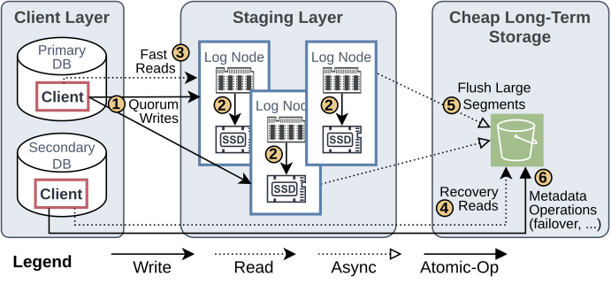
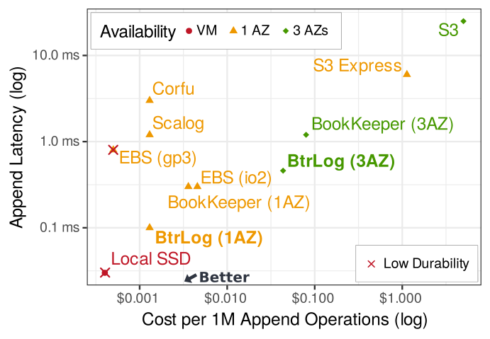

Database systems use write-ahead logging (WAL) to ensure durability: before a transaction commits, its log records must be persisted. On-premise databases can write their logs to local SSDs, achieving durable commits with very low latency. In the cloud, however, instance-local disks are ephemeral and may disappear when a machine fails[^1]. Cloud databases, therefore, need a durable remote logging backend. Surprisingly, none of the standard cloud storage services is well-suited for this task.

S3 offers excellent durability and low storage cost, but as discussed in [a previous post](./s3_is_the_future_and_the_past.md), it is essentially a million hard disks behind an HTTP API: a write takes tens of milliseconds, and write costs are high. Even S3 Express One Zone has multi-millisecond latency. Since every commit waits for the log, putting your WAL on S3 forces your OLTP system to become a batch system.

Remote block storage such as Amazon EBS is the traditional alternative, but it is much slower than the hardware it runs on. We compared the write latency of the hyperscalers' block storage to a network round trip plus a local SSD write, the physical lower bound for a durable remote write:

|                       |    AWS |    GCP |  Azure |
|----------------------:|-------:|-------:|-------:|
|  Network + local SSD  |  76 µs |  71 µs | 301 µs |
| Remote block storage  | 311 µs | 453 µs | 776 µs |
|                Factor |   4.1× |   6.4× |   2.6× |

Block storage is also expensive: EBS io2 bills for provisioned IOPS whether you use them or not, and 256,000 IOPS cost $9,651 per month. So much for the cloud's elasticity promise.

The industry has recognized this problem. Microsoft's Socrates, Huawei's TaurusDB, and Neon built specialized logging backends, and AWS has an internal "Journal" service that powers Aurora DSQL, S3, DynamoDB, Lambda, and Kinesis[^2]. Yet all of them are proprietary or tied to a particular database architecture. The open-source alternative, Apache BookKeeper, by default waits up to 2 ms to group journal writes, which is reasonable for disks but long compared to the roughly 30 µs SSD writes we measured on AWS instances. Which raises the question: why is there no generally available cloud service for durable, low-latency log appends, just as there is S3 for objects?

In our recent BtrLog paper[^3], we investigate what such a service could look like. The interface is simple: append records, make them durable, and read them back during recovery. Making it durable, cost-efficient, and fast is the hard part. General-purpose log systems assume many concurrent writers, so somebody has to decide on the order of appends. Consensus protocols such as Paxos and Raft route every append through a leader, which costs two network round trips. Shared logs, such as Corfu and Scalog, add a dedicated sequencer, also costing additional network round trips.

Database logs, however, are not general-purpose. Many cloud database systems have exactly one writer per log: Aurora, Azure SQL Hyperscale, PolarDB, and AlloyDB each have a single primary writer, and in Spanner, every Paxos group has a leader. That writer already knows the order of its log records. If it assigns the log sequence numbers itself, ordering becomes free: the writer sends each record to three log nodes with NVMe SSDs in parallel and considers it durable once two of them (a write quorum) have persisted it. That is a single network round trip, and the quorum hides stragglers because the slowest node never matters. The complexity moves to failover, where a new primary must fence off the old one and figure out the correct end of the log, but that is a rare event off the critical path.

Keeping the entire log on replicated SSDs would be expensive, both per append and per gigabyte. This is where S3 becomes useful. BtrLog's log nodes only hold the active tail of the log. Once a 16 MB segment fills, it is flushed asynchronously to S3. For 1 KB log records, this reduces the S3 request cost to just $0.0003 per million appends. And because log nodes keep only the active tail, historical log data does not occupy expensive replicated SSD capacity. S3 thus does what it is actually good at: cheap, durable long-term storage with high read bandwidth for recovery. For the lowest latency, BtrLog runs three log nodes within one availability zone (AZ). For stronger availability guarantees, it distributes six log nodes across three AZs, which tolerates the loss of an entire AZ plus one more node.

How close to the hardware does this get? In AWS, a network round trip within a partitioned placement group can take about 40 µs[^4] and a local SSD write about 30 µs. At low load, BtrLog's median append latency is around 70 µs: matching the measured hardware lower bound and 4× lower than EBS io2. Even with log nodes spread across three AZs, BtrLog is almost as fast as a single-AZ EBS volume. The following figure compares latency, per-append cost, and availability of all options:

Writing every commit directly to S3 costs about $5 per million appends, four thousand times more than BtrLog (assuming fully utilized log nodes). The large gap between local SSDs and existing remote options is not necessarily a law of nature: careful design and implementation close most of it.

There is a broader opportunity for a low-latency logging backend. Logging is not specific to databases. It is used in distributed file systems and streaming systems and is an important primitive for agents[^5]. Today, many systems operate their own logging infrastructure. A shared logging service could host thousands of independent logs on a common pool of log nodes (a single BtrLog node already served over 2,000 concurrently active logs in our experiments). Multi-tenancy is also economically attractive: instead of provisioning dedicated IOPS for each tenant's peak load, as with EBS, a shared service can exploit the fact that tenants do not peak at the same time.

None of the ideas behind BtrLog are radically new: quorum replication, client-driven ordering, and tiering to cheap storage are textbook techniques. What is missing is a reusable service that combines them effectively and efficiently for the cloud and modern hardware. Cloud platforms make it easy to provision virtual machines, object storage, and block devices, but applications still have to assemble something as fundamental as a durable log themselves. AWS treats logging as a fundamental primitive internally. The rest of us should too. We've made the [BtrLog prototype and protocol specification](https://github.com/maxi-k/btrlog) publicly available.

[^1]: <https://docs.aws.amazon.com/AWSEC2/latest/UserGuide/instance-store-lifetime.html>
[^2]: <https://www.youtube.com/watch?v=huGmR_mi5dQ&t=627s>
[^3]: Maximilian Kuschewski, Lam-Duy Nguyen, Matthias Jasny, Tobias Ziegler, Viktor Leis, Muhammad El-Hindi: BtrLog: Low-Latency Logging for Cloud Database Systems. PVLDB 19(10), 2026. <https://doi.org/10.14778/3828612.3828640>
[^4]: We found that the latency can vary significantly across deployments. 40 µs is the lowest that we measured across multiple deployments.
[^5]: Stay tuned for future blog posts about this.
